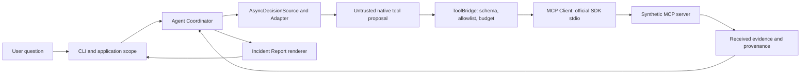

# Linux Log AI Agent: Agent Technical Report

**SCRUM-44 / P04-08 — English report draft**

**Evidence and repository snapshot: 15 November 2026**

## Abstract

Linux Log AI Agent is a student project that aims to turn a diagnostic question
into a bounded sequence of read-only observations and an evidence-linked incident
report. The application validates proposed tools, maintains the execution state
and controls resource cleanup. A language model assists with tool selection and
interpretation; it does not receive operating-system privileges or approval authority.

The current evidence demonstrates a synthetic integration pipeline and one successful
Live Ollama + Synthetic MCP active-service smoke test. It does not establish real
Linux diagnostic accuracy, successful remediation, VM acceptance or production
readiness. This document brings together implementation and existing evidence;
**no tests, inference, benchmarks or experiments were rerun for this writing task**.

## 1. Project overview and objectives

The intended workflow is: a user describes a problem, the Agent selects relevant
observations, examines the returned evidence and produces a report with citations
and uncertainty. The project targets a CLI, one selected LLM and 12 tool contracts:
11 read-only tools and one approval-gated restart facade. This is the planned scope;
availability of all 11 read-only collectors in the target runtime is unverified.

The evaluation plan identifies S1 crash loop, S2 Nginx configuration syntax error,
S3 port conflict, S4 backend failure causing HTTP 502 and S5 a nearly full test
filesystem. The planned baseline is five cases with three repetitions: 15 runs.
Optional approved extensions could increase this to six/seven cases and 18/21 runs.
These are evaluation requirements, not completed experiments. The Week 2 gate
specifically requires S1/S2/S4 and manual review. [The gate report][gate] preserves
the planning references and their hashes.

Implementation is distributed across branches. At this snapshot, PRs #7–#12 and
#15–#19 are Open/Draft. Main at `990f41f` contains the architecture/security documents
and synchronous Adapter; it does not contain the complete pending Agent stack.
This documentation PR is based on main and references the separate implementations
at immutable commits. Reading this report does not require merging their branches.

## 2. Agent architecture and trust boundaries

The [architecture][architecture] separates the diagnostic read plane from the
planned approval/helper write plane. In the implemented demo, the CLI wires the
Coordinator, model decision source, ToolBridge, MCP Client and synthetic server:

The [integration demo][demo] follows the pipeline shown above. Real collectors and the
privileged write plane are outside it. The model backend can be mock or explicitly
selected local Ollama; this choice does not turn synthetic server data into Linux
observations. [Implementation wiring][session] retains all component owners.

| Boundary | Application responsibility | Important limit |
|---|---|---|
| User/model to policy | Trusted configuration owns tools, unit scope, schemas and launch commands | User prose or model output cannot grant permission |
| Model to tool dispatch | Validate native call name/arguments, read-only policy and budgets | Discovery and annotations do not confer authority |
| MCP result to Agent/model | Bound, validate and redact data; preserve errors and evidence identity | Log text remains untrusted even with a valid schema |
| Agent to report | Resolve citations, retain uncertainty, escape output | Citation membership does not prove semantic correctness |
| Read plane to future write plane | Protected approval/control channels and helper policy | Not implemented or accepted by the synthetic UI |

The target deployment uses separate operator, read-plane and approval/helper roles.
Agent and stdio child server share a UID in the design: their protocol boundary is
not OS isolation. Those UID/service arrangements are deployment requirements,
not proof of an accepted VM configuration. [Security policy][security] requires
least privilege and a separate authorization path for writes.

## 3. Local LLM integration

The selected baseline is `qwen3:4b-instruct-2507-q4_K_M`. Trusted application
configuration uses `http://127.0.0.1:11434`, context 4096, output cap 256,
temperature 0, four threads and non-streaming requests; the Instruct path omits
`think`. Model/endpoint selection is not taken from the user's question.
The [synchronous Adapter][adapter] validates messages, native function calls,
arguments and response policy, and normalizes usage/latency and safe error codes.
It does not execute a proposed tool or convert JSON embedded in prose into a
native tool call.

The [async integration][async] runs synchronous HTTP in an owned subprocess so
that it does not block the event loop. It bounds IPC and concurrent ownership,
rejects late results after cancellation/deadline, and retains process cleanup
through terminate, kill if required, and join. Synchronous API compatibility is
preserved. Stopping this worker does **not** prove the Ollama backend has stopped
inference. Cancellation guarantees concern application state and owned resources,
not an unobserved provider-side operation.

[AsyncDecisionSource][decisions] returns either a validated tool proposal or a
conclusion with existing evidence IDs. Before any evidence exists, the first-tool
policy requests a native call and enables local `require_tool` validation. Text-only
output fails closed without retry or fabricated evidence. This is not a claim that
Ollama always produces native calls, nor an unsupported `tool_choice` guarantee.

The general Coordinator limits are eight tool calls, six model turns and a
120-second diagnosis budget. The trusted live demo narrows this to the active
scenario, at most two model requests, one synthetic dispatch and 45 seconds per
request including worker startup. Cleanup has separate ownership/budgets; these
numbers do not establish a hard wall-clock SLA. [Trusted backend scope][live]
records the factory, limits and historical smoke evidence.

## 4. MCP Client and ToolBridge

The [MCP Client][client] uses the official Python MCP SDK 2.3.0 over stdio. The
validated runtime baseline recorded in the gate evidence is Python 3.12.16.
The client owns initialization, discovery, calls, disconnect and SDK context
cleanup. Its generic interface does not interpret project-specific business
response envelopes. Server executable/arguments and the client allowlist come
from trusted configuration.

[ToolBridge][bridge] validates one proposal against trusted JSON Schemas and a
read-only registry, applies tool/time/output budgets, and preserves bounded safe
results. It does not treat discovery or model claims as authorization. It retains
`content`, `structuredContent` and `isError` for higher-level interpretation.
Transport timeout/disconnect after dispatch can leave the execution outcome
unknown; the application does not invent a successful response, automatically
retry/reconnect, or infer a particular exit code from generic EOF.

The synthetic demo uses an explicit fixture schema and provenance adapter, not the
unfinished production binder. Canonical mock bindings in #15/#16 separately use
PR #6 revision R1 at `d442479`, with application-created session/trace/logical-call/
attempt IDs and full input/output validation. Provider call IDs, logical IDs,
attempt IDs and SDK JSON-RPC IDs have different roles. The generic Client does not
manufacture business metadata or evidence. Candidate contract use does not confer
final contract or security signoff.

## 5. Agent Coordinator and reasoning loop

The [Coordinator implementation][coordinator] owns the state machine. For the
successful active fixture, the observed trace is:

`RECEIVED → ANALYZING → COLLECTING → ANALYZING → CONCLUDED → REPORTED`

Multi-tool scenarios repeat ANALYZING/COLLECTING. Error, cancellation and budget
exhaustion have explicit terminal paths. A `limited` outcome can use the CONCLUDED
state while retaining an uncertainty report; that state does not certify truth.

A turn exposes bounded safe observations to the decision source. The application
validates a proposed read, dispatches through ToolBridge, records the returned
observation and asks for the next decision. A conclusion must cite evidence already
in the session. The Coordinator prevents unauthorized tools, repeated proposals
without new evidence and dispatch after exhausted budgets. It preserves received
safe evidence when a budget ends instead of creating an unsupported conclusion.

In mock mode, decisions are scripted by the existing MockHTTP fixture. Multiple
turns therefore demonstrate orchestration and lifecycle, not independent LLM
reasoning. Live mode substitutes the real Adapter while retaining the same synthetic
server and dispatch controls. The current live evidence covers only one active case.

## 6. CLI and Incident Reporting

The [synthetic CLI][cli] accepts diagnostic questions, selects active/port-conflict/
permission-denied fixtures and reuses the Coordinator. The integrated CLI additionally
selects the trusted mock or Ollama backend. Output identifies the mode and labels
synthetic data. Permission denial produces a limited result rather than an invented
root cause or a claim that access was granted.

The [Markdown renderer][renderer] produces the Incident Report from application
state, conclusions, evidence and citations. Export preserves the stdout text, uses
private report permissions and enforces a safe basename, no traversal/symlink and
no overwrite. Report content is escaped and filtered. Its role is explanation;
it is not an authoritative approval/helper audit or proof that a service was fixed.

[The action confirmation UI][actions] is a separate fixture-only command. It shows
nginx.service, the proposed action, reason, risk and available evidence sources.
States are proposed/approved/rejected/expired. A local approved decision is never
executed or backend authorization. Input requires the same actual TTY for stdin
and stdout, an exact phrase with the current application-generated ID, and an
unexpired deadline. Non-TTY input, EOF, invalid input and cancellation fail closed.
No model approval token, arbitrary command, grant, control socket or helper is
accepted. TTY checks do not authenticate a human; same-UID software can drive a
pseudo-terminal. Production authorization remains separate work.

## 7. Evidence, provenance and citation handling

Evidence is received from a tool/fixture; the Agent must not invent observations,
IDs or citations to complete a narrative. Synthetic sources remain explicitly
synthetic. The Coordinator's compact Evidence projection carries ID, source and
text. The canonical bindings retain richer safe ledgers, including observed_at,
unit, redacted/truncated flags and baseline references. Full ledger-to-report
integration remains unfinished.

ToolBridge can provide an internal tool-role message. The current decision source
serializes Coordinator observations as labelled untrusted user data because that
projection lacks authoritative tool-call correlation. It does not manufacture
role=tool metadata by parsing a source string. Schema validation and redaction do
not promote tool output into a system instruction or establish semantic truth.

[detect_anomaly binding][anomaly] validates received canonical findings, evidence
references and time windows. It does not itself detect anomalies or implement a
collector. [verify_fix binding][verify] preserves absent/null optional arguments,
known baseline/action references and fresh check evidence. Partial, unknown,
truncated or unsupported checks do not satisfy local checks_passed. Even a received
pass is not proof that remediation occurred. The canonical verify mock returns
partial/unknown without evidence, and its SDK test asserts that limitation.

## 8. Safety restrictions and cleanup lifecycle

Application and server allowlists remain read-only within the demos. No arbitrary
shell, sudo, real restart, privileged helper or automatic approval is involved.
The intended resolution of NoNewPrivileges versus sudo is architectural: the read
plane does not elevate itself; any future privileged action belongs to the separate
reviewed helper path. This report does not claim that hardening has been deployed.

Redaction occurs before data reaches model transport, with additional boundary
filtering and context-appropriate output escaping. Secret-bearing tool arguments
are rejected rather than silently changed. Errors use safe codes rather than raw
provider bodies, prompts or reasoning. Pattern redaction has known coverage and
false-positive limits; it is not clearance to process real sensitive logs.

`run_coordinator()` joins model and executor ownership; DemoSession also owns
Client disconnect and full-session cleanup. Request expiry cannot silently abandon
an owner. If cleanup is pending, retain the owner/session/event loop, report the
pending state and rejoin without retrying inference or an action. Tests observe
child return codes and ownership state at specific points; they do not prove
unconditional teardown under every OS failure. Post-parse output caps are also not
a pre-parse memory-allocation guarantee. [Lifecycle code][session] and [boundary
regressions][bridge-tests] document these limits.

## 9. Testing methodology and verified results

Evidence has several distinct levels:

| Level | What executes | What the evidence establishes |
|---|---|---|
| Unit/mock tests | Controlled HTTP responses and application fixtures | Validation, error policy and orchestration behavior |
| Mock LLM + Synthetic MCP | Fake HTTP transport in a real worker; official SDK stdio and synthetic server | End-to-end fixture dataflow, budgets, reports and observed cleanup |
| Live Ollama + Synthetic MCP | Real local inference and the synthetic server | The recorded active-case integration smoke only |
| Real Linux diagnostics | Requires accepted collectors, lab/VM and ground truth | Not yet verified by the evidence in this report |

### 9.1 Historical local tool-selection benchmark

[The evaluator's recomputation][metrics] uses the archived 1 November benchmark:
18 live LLM requests with mock tool definitions, no MCP dispatch. Native tool name
selection was 18/18, as was exact tool-plus-arguments matching. Median model-request
latency was 3.173447 seconds; mean was 4.556067 seconds. The recorded timeout/error
count was 0/18. These results concern the six-case selection protocol, not root-cause
accuracy or the project's S1–S5 lab evaluation.

Diagnostic/evidence correctness, citation validity, cleanup, safety and verification
are NOT_EVALUABLE from that archive. Semantic correctness requires independent
rubric/ground-truth assessment. The evaluator separates modes/protocol/config/
revision/latency scopes, deduplicates stable run identities and exposes denominators.
A valid hash reference is provenance, not authentication of a submitted claim.

### 9.2 Historical live integrated smoke v2 — 14 November 2026

| Observation | Recorded result |
|---|---|
| Scenario | active only — PASS within this scope |
| Runtime/model | Python 3.12.16, MCP 2.3.0, Ollama 0.40.13; pinned Qwen3 4B Instruct |
| Model requests | 2 |
| Native selection | service_status with {"unit":"nginx.service"} |
| MCP dispatches | 1, to the synthetic server |
| Evidence/citation | active-service_status; synthetic source preserved |
| Conclusion | Validated conclusion JSON with an existing citation |
| Total recorded time | 28.188 seconds |
| Output/cleanup | Report and stdout matched; owners cleared; observed workers/server exited 0 |

This table is transcribed from [the committed v2 evidence summary][live]; it is not
a new smoke test. Its raw/runtime artifacts remain outside Git. The earlier v1
returned text-only and failed first-tool policy; v2 followed the policy correction.
One successful invocation is not a reliability benchmark, a causal A/B study or
proof that future requests always select tools correctly. It does not establish
Linux health or provider-side cancellation.

### 9.3 SCRUM-39 offline gate evidence — 15 November 2026

[The Week 2 report][gate] records **356 offline tests PASS, 0 FAIL/SKIP**: four new
gate probes plus 352 existing regressions. The component counts are 57 Adapter,
46 Client, 50 Boundary, 4 fixture acceptance, 60 Coordinator/report, 35 CLI,
33 async Adapter and 67 integration/backend/policy tests. These 352 plus the four
new probes form one recorded validation set. Older overlapping totals and the
independent binding/UI/evaluator suites are not added to it.

[Actual offline observations][observations] show active (2 mock turns/1 dispatch),
port-conflict (3/2), permission-denied (3/2, limited), and a cap-one port-conflict
probe (2/1, budget_exhausted, first evidence retained). Probe source hashes,
provenance references and cleanup/return-code observations are recorded. All
conclusion_verified flags are false. Scripted success is not LLM accuracy.

**Formal Week 2 acceptance remains BLOCKED:** required S1/S2/S4 VM/model traces,
accepted 11 read-only tools and independent manual review are missing. PASS here
validates offline behavior; the formal gate has not passed. Unit PASS counts are
never accuracy denominators. No execution was repeated for this report.

## 10. Limitations and unfinished integrations

1. Most Agent components are pending Draft PRs, with stacked dependencies. The
   integrated demo does not automatically include every independent binding/UI.
2. Synthetic fixture schemas and the canonical mock bindings are distinct layers.
   Production registry/binder adoption requires a reviewed contract handoff; this
   report does not finalize contracts or approve another member's implementation.
3. No accepted real-Linux collector/VM/topology, 11-R runtime proof or S1/S2/S4
   ground-truth trace set is established here.
4. One live active smoke cannot establish root-cause accuracy, general tool-calling
   reliability, performance under VM load or all-scenario completion.
5. Citation checks establish reference membership. Evidence relevance, causal
   sufficiency and diagnosis correctness still need independent review.
6. Rich ledger/report integration, real-data privacy validation and production
   deployment hardening remain incomplete. Cleanup and provider cancellation have
   the limits described above; no hard wall SLA is claimed.
7. The action UI grants no authority. Protected approval coordination, authenticated
   control channels, replay-resistant grants, audit and privileged execution remain
   separate work. No successful remediation or VM/security acceptance is claimed.

## 11. Future work and conclusion

Thủy's handoff should provide reviewed contracts/registry, read-only collector
behavior, launch topology and provenance/error semantics. Trang's handoff should
provide accepted VM/snapshot/least-privilege conditions and S1/S2/S4 labs with frozen
ground truth. Hiền can then connect a narrowly scoped read-only production binder,
retain complete evidence and run separately approved fixed-model CLI/VM tests.
The group should manually review the traces before deciding the Week 2 gate.

The later formal evaluation should lock versions/configurations and the rubric,
collect the planned 15 baseline runs, report denominators and disagreements, and
keep unknown results visible. Write operations must remain disabled until their
independent security/approval/helper requirements are met.

The present contribution is a reviewable Agent foundation: bounded orchestration,
validated interfaces, synthetic integration, one narrowly scoped live-LLM smoke
and reproducible offline evidence. It is a basis for the final report and slides;
formal integration/evaluation acceptance remains unfinished.

## Appendix: source and revision ledger

All listed PRs were Open/Draft when read on 15 November 2026. Short SHAs identify
the snapshot; links below resolve immutable full commits. PR status may change
later without changing the evidence cited here. Documentation review checked
source links, terminology, numerical consistency and the separation of evidence
levels. It did not rerun any experiment or constitute an independent security signoff.

| Source | Snapshot | Material used |
|---|---|---|
| Main | 990f41f | Architecture/security and synchronous Adapter |
| PR #7 | 9c7fbc14 | MCP Client, ToolBridge and lifecycle documentation |
| PR #8 | 61cdff0d | Coordinator, evidence projection and renderer |
| PR #9 | ab05df01 | Original CLI, report storage and fixtures |
| PR #10 | 4cb5ab66 | Async Adapter/worker ownership |
| PR #11 | a7d5e945 | Integrated synthetic pipeline |
| PR #12 | 440c2004 | Trusted factory, first-tool policy and live v2 summary |
| PR #15 | 2e1698eb | Canonical mock anomaly binding |
| PR #16 | fbbc6c29 | Canonical mock verification binding |
| PR #17 | 264626cc | Synthetic action confirmation UI |
| PR #18 | 2706a15d | Metrics definitions and historical benchmark recomputation |
| PR #19 | 4ae61dd1 | Offline gate matrix and actual observation artifact |

The implementation commands in linked READMEs require their corresponding source
checkout/dependencies. The main-based documentation branch does not bundle these
unmerged modules. No figures extrapolate beyond the recorded measurements.

[architecture]: https://github.com/hienne215/linux-log-agent/blob/990f41f68c8ef13218bf825bd57ff233a8c82f1c/docs/ARCHITECTURE.md
[security]: https://github.com/hienne215/linux-log-agent/blob/990f41f68c8ef13218bf825bd57ff233a8c82f1c/docs/SECURITY.md
[adapter]: https://github.com/hienne215/linux-log-agent/blob/990f41f68c8ef13218bf825bd57ff233a8c82f1c/src/agent/llm/README.md
[async]: https://github.com/hienne215/linux-log-agent/blob/4cb5ab6615db22ca8ce246c65686da15616b4aee/src/agent/llm/async_adapter.py
[decisions]: https://github.com/hienne215/linux-log-agent/blob/440c2004a7742f75550765b9db339734740d80f3/src/agent/llm/decision_source.py
[client]: https://github.com/hienne215/linux-log-agent/blob/9c7fbc14e5526305e69ae4ca835153872211de28/src/agent/mcp_client/client.py
[bridge]: https://github.com/hienne215/linux-log-agent/blob/9c7fbc14e5526305e69ae4ca835153872211de28/tests/integration_boundary/README.md
[bridge-tests]: https://github.com/hienne215/linux-log-agent/tree/9c7fbc14e5526305e69ae4ca835153872211de28/tests/integration_boundary
[coordinator]: https://github.com/hienne215/linux-log-agent/blob/61cdff0d2674f14150a1e7df5940a1372b8c1d24/src/agent/coordinator.py
[renderer]: https://github.com/hienne215/linux-log-agent/blob/61cdff0d2674f14150a1e7df5940a1372b8c1d24/src/agent/incident_report.py
[cli]: https://github.com/hienne215/linux-log-agent/blob/ab05df010a5dc95faf2adbfa6ee997387d2dbc1e/src/agent/cli/__main__.py
[session]: https://github.com/hienne215/linux-log-agent/blob/440c2004a7742f75550765b9db339734740d80f3/src/agent/integration_demo/session.py
[live]: https://github.com/hienne215/linux-log-agent/blob/440c2004a7742f75550765b9db339734740d80f3/docs/TRUSTED_BACKEND.md
[anomaly]: https://github.com/hienne215/linux-log-agent/blob/2e1698eb58150db78d1ff3d3ab16de041cbfa389/tests/anomaly/README.md
[verify]: https://github.com/hienne215/linux-log-agent/blob/fbbc6c29d54b50441647852d39546ed0b6d4a147/tests/verify_fix/README.md
[actions]: https://github.com/hienne215/linux-log-agent/blob/264626ccee510ff95b3a58cb7ef9c29c7fba9e41/tests/action_cli/README.md
[metrics]: https://github.com/hienne215/linux-log-agent/blob/2706a15de002334ecb46c049d3b997255a3446d2/tests/evaluation/EXAMPLE_BENCHMARK.md
[gate]: https://github.com/hienne215/linux-log-agent/blob/4ae61dd1df8d551d3d996db0d575d79f3ce8353c/docs/SCRUM39_OFFLINE_GATE.md
[observations]: https://github.com/hienne215/linux-log-agent/blob/4ae61dd1df8d551d3d996db0d575d79f3ce8353c/tests/week2_gate/OBSERVATIONS.json
[demo]: https://github.com/hienne215/linux-log-agent/blob/a7d5e94503a44f57781e3fd8ff54f5f6009d3730/docs/INTEGRATION_SYNTHETIC_DEMO.md
