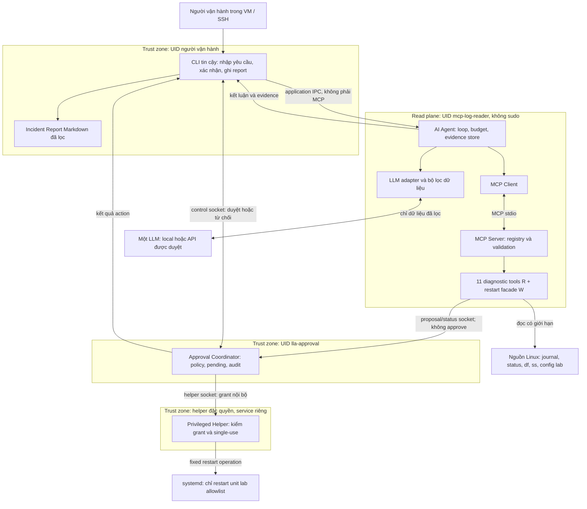
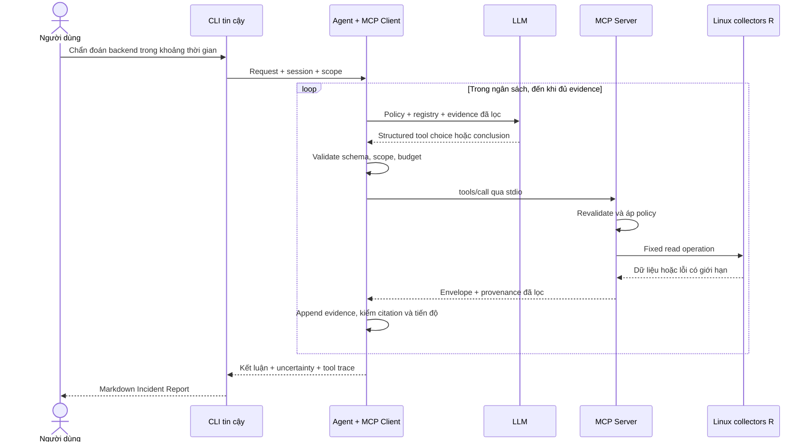

# Kiến trúc Linux Log AI Agent

Phiên bản thiết kế: 1.0 — 01/11/2026. Task: **SCRUM-11 / P00-02**. Tác giả: Hiền (Member B). Trạng thái: **đề xuất để Hiền, Thủy, Trang review**, chưa phải triển khai hoặc phê duyệt của nhóm.

## 1. Cơ sở và phạm vi

Đã đối chiếu README.md, TEAM_ASSIGNMENT, ROADMAP, TASKS, DEPENDENCIES, SPRINT_PLAN, DEFINITION_OF_DONE và đề cương `De_cuong_nhom_Linux_AI_Agent_v2.docx` ngày 01/11/2026. Checkout có HEAD `1f594f132bb7b2b585766342cb7efc729b0086d6`; README chỉ có tên dự án, các tài liệu kế hoạch hiện là file cục bộ chưa commit. Chưa có kiến trúc hoặc security trước tài liệu này. Không suy diễn trạng thái remote hay code chưa có.

Đây là ADR và thiết kế chi tiết cho P00-02; không tạo module, service, tài khoản, khóa, socket hoặc lệnh cài đặt. Schema dưới đây là đầu vào cho P00-03, không thay thế bộ 12 JSON Schema và mock do Thủy chốt. Chính sách an toàn bổ sung nằm trong [SECURITY.md](SECURITY.md).

Phạm vi cuối theo kế hoạch: CLI, một LLM, 12 MCP tools (11 R + 1 W), báo cáo Markdown; S1–S5 trong VM, mỗi ca 3 lượt. Sáu tool là gate tuần 1, không phải giảm phạm vi cuối xuống sáu. Restart là tính năng tuần 3, mặc định khóa cho tới security gate; nếu không bảo đảm approval độc lập thì giữ read-only và ghi thiếu phạm vi. Không thêm dashboard, SQLite, timer, đa máy, fine-tune, rollback hoặc LLM thứ hai vào baseline.

## 2. ADR và quyết định được đề xuất

| ID | Quyết định | Lý do và hệ quả |
|---|---|---|
| ADR-01 | Runtime mục tiêu ở một Ubuntu LTS VM; CLI dùng terminal trực tiếp hoặc SSH vào VM | Cùng host đích cho evidence, policy và restart; không có đường helper tới laptop. LLM có thể ở endpoint local/API đã duyệt dữ liệu. |
| ADR-02 | Official MCP Python SDK, transport **stdio**; Agent khởi chạy server con bằng entrypoint cố định | Ít thành phần mạng cho một client; mock dùng cùng transport. Pin SDK và protocol tương thích ở P00-03, không tự viết JSON-RPC hoặc coi phiên bản spec tham khảo là version đã khóa. |
| ADR-03 | CLI tin cậy chạy dưới UID người vận hành; Agent và MCP con chạy dưới UID ít quyền `mcp-log-reader` | CLI không nhúng Agent trong cùng tiến trình/UID. Read plane dùng chung UID là lựa chọn MVP có giới hạn cách ly rõ ở §3; không dùng stdio làm cơ chế chuyển UID. |
| ADR-04 | Coordinator UID `lla-approval`; helper service riêng do systemd khởi động với đặc quyền cần thiết | Agent chỉ gửi đề xuất. Control socket chỉ nhận UID người vận hành; helper chỉ nhận UID coordinator. Không sudo, không chuyển shell qua MCP. |
| ADR-05 | Structured tools, vòng lặp có ngân sách; evidence store và report xác định bằng ứng dụng | LLM đề xuất và phân tích; code validate quyết định có thực hiện tool hay không. Report phân biệt facts, hypotheses, action outcome và verification. |
| ADR-06 | Approval gắn action ID, params, VM, session, expiry, single-use | Xác nhận một lần cho một restart; đổi unit, retry ghi, replay đều cần từ chối hoặc đề xuất mới và duyệt mới. |

Theo [MCP transports](https://modelcontextprotocol.io/specification/2025-06-18/basic/transports), stdio sử dụng server subprocess, stdin/stdout cho MCP và stderr cho log. Vì vậy stdout không được chứa log ứng dụng. Chuyển sang Streamable HTTP là ADR mới, kèm thiết kế xác thực mạng; không tự mở endpoint trong MVP.

## 3. Thành phần và triển khai logic



Mũi tên chỉ đường dữ liệu, không tự cấp quyền. Ranh giới Agent–MCP là validation/protocol; **không phải cách ly UID** trong lựa chọn stdio này. Nếu Agent bị chiếm quyền thực thi code thì kẻ tấn công có thể dùng mọi quyền đọc của `mcp-log-reader`, không chỉ 11 tools. Vì vậy giảm quyền đọc OS vẫn bắt buộc. Ranh giới ngăn ghi chủ đạo là read plane → coordinator → helper; cả Agent và MCP không được truy cập control/helper socket hoặc khóa grant.

| Thành phần | Trách nhiệm | Quyền và điều cấm |
|---|---|---|
| CLI — Hiền | Nhận câu hỏi, chọn session/VM đã cấu hình, hiển thị evidence; xác nhận tương tác; lưu report | UID người vận hành được coordinator cho phép. Không thực thi chuỗi lệnh LLM, không tự ký grant, không có tùy chọn tự duyệt. |
| Agent + LLM adapter — Hiền | Plan có cấu trúc, gọi nhiều tool, quản lý budget và evidence, tạo kết luận | Service ít quyền do systemd khởi động sẵn. Không shell tool, sudo, khóa approval hoặc API đổi policy. |
| MCP Client — Hiền | SDK lifecycle, discover tools, kiểm manifest/schema, timeout/cancel, tương quan trace | Chỉ khởi chạy executable server cố định từ cấu hình tin cậy; không nhận server URL/entrypoint từ LLM/log. |
| MCP Server — Thủy | Registry cố định, validation độc lập, dispatch, normalize lỗi, redaction | Cùng UID ít quyền với Agent, không sudo; process con thừa hưởng sandbox. Restart facade chỉ tạo/đọc trạng thái đề xuất. |
| Linux diagnostic tools — ba owner | Thu thập dữ liệu hoặc tính toán từ evidence; giới hạn tài nguyên | Fixed argv không shell; đọc nguồn allowlist. Thiếu quyền trả lỗi, không nâng quyền. |
| Approval Coordinator — Trang | Pending action, human decision, policy, TTL, audit; gọi helper | UID riêng, chỉ ghi state/audit riêng. Không quyền restart trực tiếp. Không tin cờ approval từ MCP/LLM. |
| Privileged Helper — Trang | Kiểm caller/grant/policy, chống replay, thực hiện restart chính xác | Service độc lập, root là phương án MVP cần Trang review; chỉ operation restart unit cụ thể. Root helper là TCB, không phải sandbox bảo đảm tuyệt đối. |
| Incident Report — Hiền | Artifact Markdown có provenance, uncertainty, action và verify | CLI ghi vào thư mục report của người dùng; Agent không ghi tùy ý vào home. Không chứa secret/token approval hoặc raw log chưa lọc. |

### 3.1 Tiến trình và IPC

Tên sau là thiết kế, chưa tạo trên máy:

- Service Agent chạy UID `mcp-log-reader`, nhận `diagnose/cancel/result` trên pathname Unix socket ứng dụng. CLI phải xác thực peer server; service xác thực UID người dùng và session. CLI không truyền shell, executable hoặc đường dẫn report tùy ý tới Agent.
- MCP server là child stdio của Agent, cùng UID; không dùng `sudo -u`, setuid hoặc launcher đặc quyền từ Agent. Log stderr được lọc và giới hạn, không lẫn vào kênh MCP.
- Coordinator có hai pathname Unix sockets tách biệt: `proposal/status` cho read-plane UID; `control` chỉ cho UID người vận hành allowlist. Helper có socket riêng chỉ coordinator được kết nối. Quyền thư mục/socket và kiểm `SO_PEERCRED` cùng áp dụng; không dùng tên UID do request tự khai.
- Session do CLI đăng ký với coordinator qua control socket; coordinator cấp session handle cho proposal, handle này không có quyền approve. Mỗi action gắn đúng session và UID người duyệt. TTY chỉ được CLI tin cậy dùng cho nhập quyết định trực tiếp; input model/log không được chuyển vào đường nhập này.
- IPC ứng dụng và approval dùng message JSON có version, giới hạn frame đề xuất 64 KiB, reject unknown fields; đây không phải transport MCP tùy biến. Agent chỉ đọc trạng thái action thuộc session, không nhận grant.
- Registry, executable, allowlist, cấu hình service và mã CLI phải do administrator triển khai, không writable bởi read-plane UID. Token LLM chỉ vào Agent, không truyền toàn bộ environment vào child MCP.

### 3.2 Cấu trúc module dự kiến, chưa triển khai

| Module dự kiến | Nội dung | Owner |
|---|---|---|
| `src/linux_log_agent/cli/` | interactive controller, approval UI, report writer | Hiền |
| `src/linux_log_agent/agent/` | loop, policy/budgets, evidence store | Hiền |
| `src/linux_log_agent/llm/` | adapter một provider, structured output, redaction | Hiền |
| `src/linux_log_agent/mcp_client/` | official SDK client, lifecycle | Hiền |
| `src/linux_log_agent/mcp_server/` | server, registry, fixed runner, normalized errors | Thủy |
| `src/linux_log_agent/tools/` | implementations R và facade W theo owner | Theo bảng §4 |
| `src/linux_log_agent/contracts/` | schemas, manifest version, fixtures | Thủy điều phối |
| `src/linux_log_agent/approval/` | coordinator, policy, audit | Trang |
| `src/linux_log_agent/helper/` | privileged narrow entrypoint, grant validator | Trang |
| `src/linux_log_agent/reporting/` | report model/template, citation checks | Hiền |

Helper không import LLM, dynamic plugins hoặc tool executor chung. Chia package trong một repo không có nghĩa cùng service, UID hay quyền cài đặt.

## 4. Tool manifest và dữ liệu cần thống nhất

| Tool | Loại | Owner | Đặc điểm an toàn/đầu ra |
|---|---|---|---|
| query_journal | R | Thủy | Unit/thời gian/mức độ có giới hạn, journal cursor |
| search_log | R | Thủy | Log ID allowlist, không nhận đường dẫn tùy ý; literal search mặc định |
| service_status | R | Thủy | Trạng thái, exit code, restart count; thiếu quyền khác inactive |
| list_failed_units | R | Thủy | Chỉ quan sát danh sách units |
| disk_usage | R | Thủy | Filesystem/inode, không dọn đĩa |
| memory_oom_events | R | Trang | Phân biệt OOM, không có sự kiện và không đọc được |
| failed_logins | R | Trang | Journal/auth.log đã chuẩn hóa, IP pseudonym ổn định |
| listening_ports | R | Thủy | Port/socket; process có thể unknown do quyền |
| check_config | R | Thủy | Fixed validator cho config lab; thiếu quyền thì không thực hiện |
| detect_anomaly | R | Hiền | So sánh cửa sổ log, trả counts/baseline; không tự gọi LLM |
| verify_fix | R | Hiền | Service + health + log mới; pass/fail/unknown, không sửa |
| restart_service | W facade | Trang | Chỉ tạo proposal hoặc đọc status; ghi thật nằm ngoài MCP tại helper |

`detect_anomaly` và `verify_fix` chạy trong registry MCP như các tool R khác. Chúng tái sử dụng hàm collector nội bộ, không tạo Agent lồng nhau hoặc MCP recursion. Nếu validator cấu hình cần ghi file tạm, profile chưa chứng minh là R hoặc cần đọc secret ngoài quyền thì trả `UNSUPPORTED`/`PERMISSION_DENIED`, không gọi helper để né giới hạn.

### 4.1 Contract chung đề xuất cho P00-03

- JSON Schema chặt: enums, min/max, độ dài, `additionalProperties: false`; không trường `command`, `shell`, `sudo`, executable, tùy chọn systemctl tự do. Canonical unit đầy đủ `.service`, reject alias/template chưa duyệt thay vì đoán tên.
- Request: `schema_version`, `session_id`, `trace_id`, tool-specific arguments. Client timeout không được vượt server policy. Timestamp RFC 3339 UTC; cửa sổ `[since, until)` và capture time rõ ràng.
- Result envelope: `schema_version`, `trace_id`, `tool_call_id`, `tool`, `status`, `timestamp`, `unit` (nullable), `data`, `evidence`, `command_source`, `error_code`, `truncated`, `next_cursor` (nullable), `duration_ms`. P00-03 quy định mapping envelope vào SDK result, không trộn lỗi protocol với lỗi tool.
- `status`: `ok`, `partial`, `error`, `approval_required`. Lỗi tool phản ánh SDK `isError` phù hợp; trường hợp proposal pending không giả là restart thành công. `error_code`: `INVALID_INPUT`, `PERMISSION_DENIED`, `TIMEOUT`, `OUTPUT_LIMIT`, `NOT_FOUND`, `UNSUPPORTED`, `POLICY_DENIED`, `APPROVAL_REQUIRED`, `EXPIRED`, `REPLAY`, `HELPER_UNAVAILABLE`, `EXECUTION_UNKNOWN`.
- Mỗi evidence: `evidence_id` do collector tạo, `observed_at`, `source` (journal cursor/file ID + line range/collector), `unit`, `excerpt` đã lọc, `redacted`, `truncated`. `command_source` là ID collector hoặc fixed argv đã lọc, không phải lệnh để Agent thực thi. Nội dung evidence vẫn untrusted.
- Empty result không đồng nghĩa permission denied; partial/truncated không được diễn giải là không có lỗi. Store giữ capture time và provenance; citation kết luận phải trỏ evidence thực có trong session.
- Giới hạn khởi điểm để nhóm duyệt: 10 giây/tool R, tối đa 64 KiB hoặc 200 events/call (chạm mức nào trước); 24 giờ/window; không unlimited pagination. Dữ liệu lớn trả partial + cursor, vẫn trừ budget. Các con số là đề xuất cấu hình, chưa benchmark.

Ví dụ **minh họa schema**, không phải kết quả chạy thật:

```json
{
  "schema_version": "1.0",
  "trace_id": "example-trace",
  "tool_call_id": "call-01",
  "tool": "service_status",
  "status": "ok",
  "timestamp": "2026-11-01T03:00:00Z",
  "unit": "lab-backend.service",
  "data": {"active_state": "failed"},
  "evidence": [{"evidence_id": "ev-01", "observed_at": "2026-11-01T03:00:00Z", "source": "systemd-status:lab-backend.service", "unit": "lab-backend.service", "excerpt": "ActiveState=failed", "redacted": false, "truncated": false}],
  "command_source": "collector.service_status.v1",
  "error_code": null,
  "truncated": false,
  "next_cursor": null,
  "duration_ms": 12
}
```

## 5. Vòng lặp chẩn đoán nhiều bước

State machine: `RECEIVED → COLLECTING ↔ ANALYZING → CONCLUDED → REPORTED`; nhánh write là `ACTION_PENDING → DENIED/EXPIRED` hoặc `EXECUTING → VERIFYING → REPORTED`. `CANCELLED`, `BUDGET_EXHAUSTED`, lỗi kết nối cũng phải tạo kết luận giới hạn nếu đã có evidence. State là ứng dụng quản lý, không để model tự tuyên bố đã chuyển trạng thái.

1. CLI nhận câu hỏi và scope VM/unit/time; ứng dụng tạo trace/session, lấy policy. Yêu cầu người dùng cũng không được bỏ qua policy. Phiên non-interactive chỉ chẩn đoán R.
2. Agent gọi LLM với system policy, registry cố định và dữ liệu đã lọc. Model trả bước tiếp theo có cấu trúc: tool R/đề xuất W hoặc kết luận; không nhận chuỗi shell.
3. Client kiểm tên tool, schema, scope và budget; server kiểm lại độc lập. Lời gọi sai không chạy; tối đa hai lần sửa structured output trước khi kết thúc có lý do.
4. Tool đọc bằng collector cố định, áp timeout/process-group cleanup và output caps; normalize/redact trước khi evidence vào context/API. Store chỉ append theo tool-call ID, giữ provenance và lỗi.
5. Agent so sánh giả thuyết với evidence, tìm bằng chứng phản bác, chọn phép đọc bổ sung. Ví dụ status failed → journal theo thời gian → config hoặc port tùy evidence, thay vì gọi mọi tool.
6. Dừng khi đủ evidence cho kết luận hoặc hết ngân sách: đề xuất 8 tool calls, 6 lượt LLM, 120 giây chẩn đoán; không tính thời gian người chờ duyệt. Thời hạn approval và verification riêng có giới hạn. Chống lặp cùng arguments nếu không có evidence mới; chỉ retry R cho lỗi transient tối đa một lần và vẫn trừ budget.
7. Kết luận nêu nguyên nhân có evidence, giả thuyết còn lại, mức chắc chắn theo chất lượng bằng chứng và dữ liệu thiếu. Không yêu cầu lưu chain-of-thought; chỉ lưu lý do ngắn có thể kiểm chứng, tool trace và citations.
8. Nếu cần restart, đi §6; nếu không, CLI tạo Incident Report. Mọi kết luận không có citation hợp lệ bị gắn nhãn chưa xác minh. Hủy/model/API hỏng không kích hoạt write dự phòng.



## 6. Restart có xác nhận độc lập

`restart_service` là tool W về ngữ nghĩa nhưng MCP process **không thực hiện restart**. Request đề xuất: `mode=propose`, `session_id`, `trace_id`, `unit`, `reason`, `evidence_ids`. Request đọc: `mode=status`, `action_id`, session; không trường `approved=true`, token hoặc execute mode cho Agent. Coordinator rate-limit pending proposals, kiểm unit canonical và session trước khi tạo action ID ngẫu nhiên. Tên unit ví dụ chỉ dùng trong tài liệu; allowlist thực tế do Trang chốt trong VM.

Coordinator giữ bản ghi authoritative gồm version, `action_id`, `trace_id`, `session_id`, `environment_id`, `action=restart_service`, canonical `params={unit}`, params digest, policy version, approver UID, created/expiry, state. TTL đề xuất 60 giây; binding không dựa vào mô tả LLM. CLI tải chính bản ghi này từ control socket để hiển thị unit, VM, gián đoạn dự kiến, hạn duyệt; không dựng màn hình duyệt từ text model. Người dùng nhập xác nhận gắn action ID; mặc định từ chối, không đọc quyết định từ stdin pipe/model/API.

Sau xác nhận, coordinator tái kiểm policy và phát grant nội bộ tới helper. Grant có HMAC-SHA-256 trên canonical serialization đầy đủ payload, gồm các binding trên, approver, expiry và helper epoch. Khóa ngẫu nhiên chỉ coordinator/helper đọc được, không tới CLI/Agent/MCP/LLM, không log. Chi tiết serialization/key lifecycle do Trang chốt P03-04; dùng thư viện chuẩn, không tự chế thuật toán mật mã. Helper kiểm caller UID, MAC, epoch, expiry, params và **policy allowlist riêng** trước mỗi execute; thời hạn nội bộ dùng deadline monotonic và fail closed khi dịch vụ khởi động lại. SECURITY mô tả single-use/crash semantics.

```mermaid
sequenceDiagram
    actor U as Người dùng
    participant C as CLI UID người vận hành
    participant A as Agent + MCP facade
    participant Q as Coordinator UID riêng
    participant H as Helper service riêng
    participant S as systemd trong VM
    participant V as verify_fix R
    A->>Q: Propose restart canonical unit + session
    Q->>Q: Validate scope, policy, tạo pending action
    Q-->>A: approval_required + action_id
    C->>Q: Get pending qua control socket
    Q-->>C: Authoritative action + impact + expiry
    C->>U: Xác nhận đúng action ID và unit?
    alt Từ chối, hết hạn hoặc không có tương tác
        U-->>C: Từ chối hoặc không xác nhận
        C->>Q: Deny nếu có quyết định
        Q->>Q: Denied hoặc expired; audit
        Q-->>A: Status denied/expired; không gọi helper
    else Người dùng xác nhận hợp lệ
        U-->>C: Xác nhận action ID
        C->>Q: Approve qua control socket đã xác thực UID
        Q->>Q: Revalidate, audit, tạo internal grant
        Q->>H: Execute grant qua helper socket
        H->>H: Caller + MAC + policy + atomic single-use
        H->>S: Fixed restart đúng unit
        S-->>H: Job result hoặc timeout
        H-->>Q: action_id + outcome + completed_at
        Q-->>C: Kết quả authoritative
        Q-->>A: Status qua poll, không có grant
        A->>V: Kiểm chứng với action_id và mốc sau action
        V-->>A: pass/fail/unknown + evidence mới
        A-->>C: Diagnosis + action outcome + verification
    end
    C-->>U: Incident Report gồm cả denied/fail/unknown
```

Helper ưu tiên API systemd D-Bus cố định `RestartUnit(canonical_unit, fixed_mode)` và theo dõi job result, không nhận method/bus destination tùy ý. Nếu nhóm chọn fixed argv thay thế, phải review lại adapter, absolute executable, arguments và timeout; không thêm shell. D-Bus authorization và hardening phải được Trang kiểm trong VM trước khi bật W.

Không tự retry write khi timeout hoặc mất kết nối. Helper đã consume grant nhưng chưa biết kết quả thì `execution_unknown`; chỉ đọc trạng thái/evidence để đối soát. Restart thành công chỉ nói thao tác hoàn tất, không chứng minh lỗi đã sửa. `verify_fix` dùng thời điểm/cursor sau action, polling R có deadline đề xuất 30 giây, service status + health profile cố định + log mới. Không đủ quyền/evidence thì unknown; active nhưng health lỗi thì fail. Health check chỉ endpoint lab allowlist, không URL do LLM chọn. Restart không rollback toàn trạng thái.

## 7. Incident Report

Report schema version 1.0, writer thuộc CLI, file basename do ứng dụng sinh trong thư mục cấu hình của người vận hành; không dùng tên/đường dẫn trong log. Escape control characters, HTML và Markdown nguy hiểm; nội dung log là quoted data.

Các phần bắt buộc:

1. Incident/trace ID, VM/environment, UTC window, thời gian chạy, app/schema/model/prompt/policy version.
2. Yêu cầu và scope, triệu chứng, facts có evidence IDs và nguồn/mốc thời gian.
3. Nguyên nhân đề xuất, hypotheses khác, uncertainty, thiếu quyền/dữ liệu, truncation.
4. Tool trace: tên, normalized args đã lọc, duration, status/error, evidence IDs; tool-call count và latency.
5. Đề xuất; action ID, unit, người duyệt, timestamps, approval denied/expired/approved, helper outcome (nếu có). Không chứa grant/secret.
6. Verify pass/fail/unknown, fresh evidence, hạn chế; không ghi “đã sửa” khi chỉ restart hoặc dữ liệu thiếu.

Audit authoritative của coordinator/helper tách khỏi report do Agent đóng góp; report không thể thay đổi lịch sử cấp quyền. Chỉ export bản đã lọc, raw evidence/mapping IP lưu cục bộ có kiểm soát nếu thực sự cần; retention do Trang xác nhận.

## 8. Handoff cần Thủy và Trang xác nhận

| Bên | Giao diện/quyết định cần xác nhận | Task tiếp theo | Trạng thái |
|---|---|---|---|
| Thủy + Hiền | stdio lifecycle, SDK/protocol pin, schema version/error mapping, manifest cố định, mock 12 tools | P00-03, P01-01, P02-01 | Chờ review |
| Thủy + Hiền | Evidence IDs/provenance, UTC windows, pagination/caps; collector reuse cho detect_anomaly và verify_fix | P00-03, P02-04/05 | Chờ review |
| Trang + Hiền | CLI khác UID Agent; hai coordinator sockets, session/UID binding, interactive-only UI, grant serialization và crash states | P03-01/04, P02-07 | Chờ review |
| Trang + Thủy | Quyền đọc journal/log/config, validators thật sự không ghi, process metadata thiếu quyền; facade propose/status | P03-01, P01-06, P03-05 | Chờ review |
| Trang | Root helper hẹp + systemd D-Bus, exact unit allowlist/canonical aliases, policy ownership, socket/key/audit permissions | P03-04/05/06 | Chờ review |
| Trang + Hiền | Environment ID, TTL, restart timeout, verify health profiles, cursor/time baseline, retention và redaction mapping | P02-05/08, P03-04/06 | Chờ review |
| Cả ba | Budget/caps đề xuất, threat-model giới hạn, model benchmark, security gate trước W, review ADR | P00-02/03/05, P04-04 | Chờ review |

Nếu Trang cần tách Agent và MCP thành hai UID khác nhau, stdio hiện tại phải được thay bằng thiết kế transport/launcher đã review; không thêm sudo để giữ sơ đồ. Việc này là quyết định cần ghi lại trước triển khai, không tự coi đã thống nhất.

## 9. Walkthrough thiết kế và acceptance criteria

Các trace sau là **walkthrough trên tài liệu ngày 01/11/2026**, chưa chạy app/VM, không phải kết quả test thực thi.

**W-R — một luồng đọc:** người dùng hỏi backend lỗi → CLI tạo session → Agent chọn `service_status(lab-backend.service)` → client/server validate → collector R trả failed + ev-01 → Agent chọn `query_journal` cùng unit và UTC window → evidence có nguyên nhân thoát → kết luận trích ev-01/ev-02 hoặc báo thiếu dữ liệu → CLI xuất report. Không có bước cấp quyền hoặc thay đổi Linux. Với permission denied, report ghi thiếu dữ liệu, không nâng quyền.

**W-D — restart bị từ chối:** Agent đề xuất `restart_service(lab-backend.service)` → facade chỉ tạo pending action → CLI hiển thị action authoritative → người dùng từ chối → coordinator chuyển denied, audit và trả status → helper không nhận execute → report ghi “không thực hiện restart”. Biến thể `approved=true` từ LLM không có schema hợp lệ và không có quyền control socket; hết hạn/non-interactive cũng không execute. Dữ liệu minh họa, không có restart thật.

| Hạng mục SCRUM-11 / nguồn TASKS.md | Bằng chứng tài liệu | Kết luận hiện tại |
|---|---|---|
| Sơ đồ CLI–Agent–MCP–Linux; approval/helper riêng | §3, §5–6 và ba Mermaid diagrams | Đạt ở mức thiết kế |
| Chốt transport, module, dữ liệu không tin cậy; ADR | §2–4 và SECURITY §2–5 | Có đề xuất cụ thể để review |
| Không có đường shell tự do từ LLM | Fixed registry/schema/collectors §3–6; SECURITY invariants | Đạt thiết kế; chưa kiểm bằng code/runtime |
| MCP reader không có sudo | UID/process model §2–3; SECURITY §4 | Đạt thiết kế; quyền VM chưa kiểm |
| Walkthrough một read và một restart denied | W-R và W-D ở trên | Đã walkthrough tài liệu; chưa có reviewer xác nhận |
| Cả ba review | Hiền, Thủy, Trang phải ghi nhận review | **Chưa đạt: chưa có xác nhận review của cả ba** |
| P00-02.1 checklist/contract đầu vào | §4, §8; SECURITY negative cases | Soạn xong; chờ review |
| P00-02.2 versioned ADR + diagrams | Hai file version 1.0 | Soạn xong cục bộ; chưa commit/PR |
| P00-02.3 evidence + reviewer xác nhận | W-R/W-D, bảng này | Có evidence lập luận; reviewer xác nhận còn thiếu |

Không chuyển SCRUM-11 sang Done. Phạm vi lần này dừng ở tài liệu để Hiền review. Các test thực thi thuộc task triển khai/security gate sau này, không được dùng mục tiêu accuracy ≥80% hoặc rejection 100% như số liệu đã đo.

## 10. Tài liệu liên quan

- [TASKS](TASKS.md), [DEPENDENCIES](DEPENDENCIES.md), [ROADMAP](ROADMAP.md), [TEAM_ASSIGNMENT](TEAM_ASSIGNMENT.md), [SPRINT_PLAN](SPRINT_PLAN.md), [DEFINITION_OF_DONE](DEFINITION_OF_DONE.md).
- [SECURITY](SECURITY.md) là phần security của cùng ADR; khi đổi trust boundary phải review cả hai file.
- Đề cương v2 là đầu vào ngoài repo đã đối chiếu; không sao chép file Word hoặc coi câu chữ trong tài liệu là quyền chạy lệnh hệ thống.
