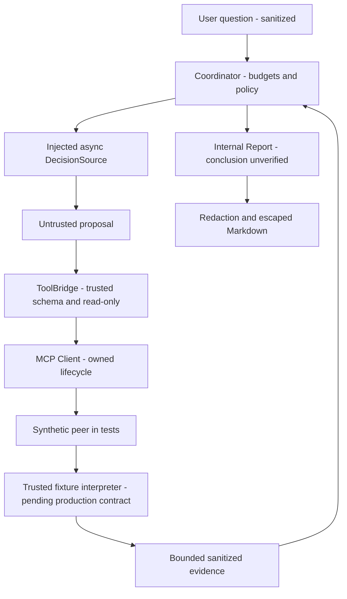

# SCRUM-24 — Read-only coordinator và Incident Report

Trạng thái: **synthetic foundation, chờ review**. Chưa hoàn tất SCRUM-24/Jira Done.
Owner: Hiền. Bản handoff DESIGN ONLY ngày 10/11 được giữ ở
`SCRUM-24_MINIMAL_LOOP_DESIGN.md` như lịch sử; tài liệu này mô tả code hiện có.

## Dependency/base

Branch `feat/SCRUM-24-agent-loop` được tạo từ exact PR #7 head
`9c7fbc14e5526305e69ae4ca835153872211de28`, không từ main mới nhất.
Đây là **stacked dependency** vào MCP Client/ToolBridge của PR #7 chưa merge.

Main kiểm tra tại lúc chuẩn bị là `990f41f68c8ef13218bf825bd57ff233a8c82f1c`.
Base chung là `7d3e21f012ae38324ab01dab4c33efe1138ba05e`; main có các squash commits
SCRUM-14/SCRUM-23 mà PR #7 base chưa chứa. Nhánh này chưa chứa implementation LLM
Adapter mới trên main và không giả vờ đã tích hợp Adapter. Chỉ file package init
`src/agent/__init__.py` được lấy nguyên nội dung từ main đã merge để package rõ ràng.

Không đưa PR #6/code Thủy vào nhánh. PR #6 hiện head
`380a0302a9a4c7b3badd857dd37b5d2c42cfd3d7`, nội dung vẫn Draft; binder/business
interpreter/official schema projection chờ chốt. Trước merge độc lập vào main,
PR7 cần được nghiệm thu và base cần đồng bộ theo phương án được Hiền cho phép.
Chưa rebase/merge hoặc tạo PR trong bước chuẩn bị này.

## Source/API

- `agent.coordinator`: application-only Evidence/Observation/Decision/Report,
  DecisionSource và Executor Protocols; Coordinator single-use.
- `agent.incident_report`: `render_markdown(report, redact=reviewed_filter)` và
  ReportError; chỉ render, không I/O hoặc tool execution.
- Trusted registry/scope predicate/redactor/result interpreter đều do ứng dụng
  cung cấp. Không nhận registry, privilege, launch command hoặc policy từ model/log.
- DecisionSource hiện là async seam cho scripted model; sync OllamaAdapter chưa được
  gắn vào. Không wrap HTTP trong background thread rồi tuyên bố đã cancel inference.

State trace thuộc ứng dụng: RECEIVED → ANALYZING/COLLECTING → terminal → REPORTED.
Model không cung cấp state. Tối đa 8 tool attempts, 6 LLM turns, 120 giây diagnosis; mỗi turn
hiện chỉ 1 proposal nên turn cap có thể bind trước 8 tools. Structured repair tối đa 2,
không retry tool hoặc reconnect. Bridge default 4 calls/30s vẫn binding nếu operator
không cấu hình scope lớn hơn. Không viết shell/restart/approval/helper path.

## Cleanup, deadline và late evidence

Coordinator giữ dispatch task, cancel tối đa 1 lần khi hết budget/caller cancellation,
join bằng cleanup_seconds riêng (mặc định 8s, tối đa 60s). Bridge/Client giữ owner
SDK/AnyIO cùng task. Không dùng connected=false làm bằng chứng đã thu hồi tài nguyên.

Nếu cleanup hết budget, giữ Coordinator và gọi finish_cleanup; không tự bỏ task.
Safe result đến sau report cleanup_pending được validate/sanitize bằng cùng helper
như normal path, rồi cập nhật report.evidence/execution_state sau rejoin. Không gọi
model tiếp; late redaction/validation failure fail closed và không biến cleanup đã
xong thành chưa xong. `state_history` ghi lịch sử run ban đầu, còn `report` có thể
được thay bằng snapshot mới sau finish_cleanup. Caller phải đọc lại coordinator.report.

Không có hard wall SLA: sync validation/redaction và executor/model không hợp tác
cancellation vẫn là giới hạn. Timeout/disconnect trước response là unknown, không
chứng minh chưa thực thi hoặc rollback. Tests kiểm owned task, references và join.

## Evidence và report

Opaque evidence giữ ID/source/text sau validation, redaction và aggregate cap;
không parse Draft business envelope trong coordinator. Citation phải resolve;
conclusion_verified luôn false ở candidate. Concluded nghĩa loop đã kết thúc, không
chứng minh semantic truth. Limited observations khiến summary dùng thông báo thiếu
bằng chứng của ứng dụng. Không tuyên bố đã restart/sửa lỗi từ transport success.

Renderer yêu cầu citation/evidence cho report concluded, từ chối refs sai, không sửa
ID âm thầm. Source và excerpt đều nằm trong vùng quoted untrusted data; markup,
HTML và terminal controls được escape/lọc. Không log payload, credentials hoặc
reasoning. Output quá cap fail closed, không truncate làm hỏng citations.

Synthetic redactor chỉ nhận sentinel, không chứng minh production secret coverage.
Có citation không chứng minh fact đúng; provenance thật/time semantics, authoritative
evidence store và semantic validation vẫn chờ contract/integration review.

## Tests và Jira gate

Dùng `python -B -I tests/agent_loop/run_tests.py` với prepared Python 3.12.16.
Dependencies được ghi tại pyproject; tất cả source/fixtures cần cho tests nằm trong
repository. Không copy venv, snapshots, audit logs hoặc external candidate data.

64 tests synthetic/unit PASS không phải Linux end-to-end. Ba Nginx fixtures gồm active,
failed+port80 và permission denied. Active chỉ là service state, không chứng minh
HTTP health. Decisions/conclusions được scripted, không phải actual LLM diagnosis.

Jira SCRUM-24 hiện To Do, phụ thuộc P02-02/SCRUM-23. AC yêu cầu chẩn đoán nhiều bước ít nhất
3 tình huống, kết thúc có kiểm soát, không tự duyệt write; hiện chỉ chứng minh control
flow synthetic và giới hạn an toàn, chưa nghiệm thu whole task. SCRUM-23 Adapter đã
merge nhưng production async orchestration/contract integration vẫn cần review.

Bước sau: review Draft foundation, chốt PR #6 và merge dependency PR #7 theo quy trình;
implementation binder/interpreter theo contract chính thức; VM/runtime/reader
permissions/redaction/RAM do Trang xác nhận; sau đó mới read-only Linux smoke và
LLM-driven diagnosis. Chưa chạy Ollama hoặc Linux tools thật trong bước này.
