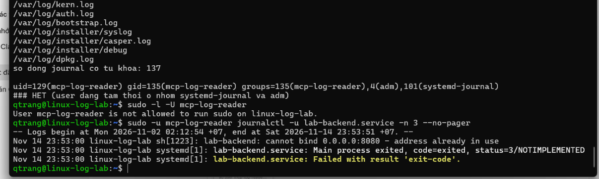

# Permission Matrix: `mcp-log-reader` (P03-01)

Status: Proposed (waiting for review)
Task: P03-01 - read permissions and Linux fixtures | Owner: Trang | Support/review: Thuy
Depends on: P00-04 (VM and snapshot), P00-02 (architecture ADR, still under review)
Date measured: 2026-11-14 | Environment: VM `linux-log-lab` (Ubuntu 20.04.6, kernel 5.15.0-139-generic)

## 1. Scope

This matrix covers the **read plane only**: the UID `mcp-log-reader` that runs the Agent and the child MCP server (ADR-03). Writes (`restart_service`) go through the approval coordinator and helper and are **not** covered here. The account was created in the VM with `scripts/p03-01/reader-user.sh`; no host setting was changed.

## 2. Account

| Item | Value |
|---|---|
| Type | System user, primary group `mcp-log-reader`, no home directory, shell `/usr/sbin/nologin` |
| UID/GID in this VM | 129 / 135 (assigned by the system; do not hard-code) |
| sudo | Not allowed (`sudo -l -U mcp-log-reader` -> "not allowed to run sudo"; Figure 1) |
| Extra groups | None by default; see sections 3 and 5 |

## 3. Measured results

Method: `scripts/p03-01/probe.sh` runs each read as `mcp-log-reader` in three stages: **A** no extra group, **B** `systemd-journal`, **C** `systemd-journal` + `adm`. Raw output: `docs/evidence/p03-01-probe-report.txt`. Sensitive files were tested only for readable/denied; contents were never printed.

Legend: Y = readable, N = denied, P = partial.

| Data / operation | A none | B +journal | C +journal +adm | Note |
|---|---|---|---|---|
| `systemctl is-active <unit>` | Y | Y | Y | |
| `systemctl --failed` | Y | Y | Y | Shows `lab-backend.service` |
| `df -h /` | Y | Y | Y | |
| `ss -tlnp` | P | P | P | Ports visible; process column empty (no process info) |
| `dmesg` (kernel ring buffer) | Y | Y | Y | Readable without any group in this VM |
| Journal: system and other users' messages | N | Y | Y | Group A sees only its own messages |
| `journalctl -u lab-backend.service` | N | Y | Y | |
| `journalctl -t lab-fixture` | N | Y | Y | |
| `journalctl -k` (OOM line) | N | Y | Y | Shown with the tag `unknown:` |
| `/var/log/syslog` | N | N | Y | |
| `/var/log/auth.log` | N | N | Y | |
| `/var/log/nginx/error.log` | N | N | Y | |
| `/etc/nginx/nginx.conf` | Y | Y | Y | World-readable |
| `nginx -t` | P | P | P | "syntax is ok", but alert: cannot open the error log (13: Permission denied) |

**Not readable in any stage (A, B, C):** `/etc/shadow`, `/etc/sudoers`, `/etc/ssh/ssh_host_rsa_key`, `/root`, `/home/qtrang/.bash_history`. `sudo -n true` is refused in every stage.

## 4. Tool mapping (11 read tools)

| Tool | Needs | Status |
|---|---|---|
| service_status | No group (`is-active` verified; `systemctl show` fields not probed yet) | OK |
| list_failed_units | No group | OK |
| disk_usage | No group (`df -h` verified; `df -i` not probed) | OK |
| listening_ports | No group; process name/PID are **unknown** | OK with limit |
| query_journal | `systemd-journal` | OK |
| memory_oom_events | `dmesg` needs no group; journal history needs `systemd-journal` | OK |
| failed_logins | `systemd-journal` (journal) or `adm` (`auth.log`); real failed-login events were not tested | OK, needs data test |
| search_log | `systemd-journal` for journal IDs; `adm` for file IDs | OK with group |
| check_config | `nginx.conf` is readable; `nginx -t` always raises the log alert | **Not ready** |
| detect_anomaly, verify_fix | Reuse the collectors above; no new permission | Follows the collectors |

`restart_service`: no permission here. The account cannot use sudo.

## 5. Proposed decisions (for review with Thuy and Hien)

1. **No sudo, no sudoers entry, no Polkit rule** for `mcp-log-reader` (verified).
2. **`systemd-journal` is required** for the journal tools. It exposes the **whole** journal, not one unit: in stage B the account could read `sudo` audit lines with the full command text. Mitigation: the tool filters by allowlisted unit, and redaction runs in the collector before data reaches the LLM.
3. **`adm` is wider than needed.** It opens all of `/var/log` (`auth.log`, `syslog`, `kern.log`, installer and package logs). Prefer not to grant it: use journal-backed IDs, or give read access only to the specific nginx log files with an ACL. The ACL option is **not verified yet** (open item 1).
4. **Do not enable the nginx `nginx -t` profile** until it is proven read-only. It tries to open the error log for writing and fails, so a result cannot be trusted as clean.
5. **Report `unknown` for process info** from `listening_ports`; do not treat a blank column as "no process".
6. `dmesg` is readable by every user in this VM; no extra step needed.

## 6. Sensitive log review

Only file names and counts were collected; no content was opened or copied.

- 13 files under `/var/log` contain at least one of `password|passwd|token|secret|api_key`: `boot.log`, `syslog`, `kern.log`, `auth.log`, `dmesg`, `dmesg.0`, `bootstrap.log`, `apt/history.log`, `apt/term.log`, `dpkg.log`, `installer/syslog`, `installer/casper.log`, `installer/debug`.
- 137 journal lines contain the same keywords.
- A keyword match does not prove a real secret (many are normal system words). The content has not been reviewed.

Proposed handling: exclude the installer, `apt` and `dpkg` logs from the log-ID allowlist (no tool needs them); apply the redaction rules to everything else (SECURITY.md section 5.2) and review matches before any data leaves the VM.

## 7. Fixtures

Created by `scripts/p03-01/fixtures.sh up`; removed by `down`.

| Fixture | What it provides |
|---|---|
| `lab-backend.service` | A unit that always exits with status 3 and logs "cannot bind 0.0.0.0:8080 - address already in use" |
| Journal lines, tag `lab-fixture` | One error ("database connection refused") and one warning ("slow request 5231ms") |
| Simulated OOM line | A kernel-log line written through `/dev/kmsg`. It is **not** a real OOM: no process was killed and no memory was exhausted |

## 8. Open items

1. Verify the ACL option for `/var/log/nginx/*.log` (read-only for the account, no `adm`); the result will update decision 3.
2. Test `failed_logins` against real SSH failures and `service_status` fields from `systemctl show`.
3. Confirm with Hien that this matrix matches the final P00-02 ADR; confirm with Thuy whether to take a new snapshot after these changes.
4. Review the content of the 13 keyword-matching files and write redaction fixtures.
