# Lab Environment Setup Guide (SCRUM-13 / P00-04)

Status: Proposed (waiting for review)
Task: SCRUM-13 (P00-04) - VM snapshot and resource inventory
Owner: Trang | Reviewer: Hien
Date measured: 2026-11-02 (inventory, 3B test); 2026-11-04 (restore re-test, 4B test)

## 1. Purpose and scope

This document records the host resources, the lab virtual machine (VM), the clean snapshot, how to restore it, and a test of running the VM and a local LLM at the same time.

All measurements were taken on one team member's **low-spec laptop (8 GB RAM, no discrete GPU)**, so section 7 is a worst-case reference, not a team decision. Other members should repeat the checks on their own machines.

All fault scenarios run only inside the VM. The Windows host is never used for fault injection.

Screenshots are in `docs/images/` (Figures 1-16).

## 2. Host inventory

| Item | Value |
|---|---|
| OS | Windows 11 Home Single Language, build 26200 |
| CPU | 12th Gen Intel Core i5-1235U, 10 cores, 12 logical processors |
| RAM | 7,877 MB total |
| Disk (C:) | 213.37 GB used, 57.06 GB free (at measurement time) |
| GPU | Intel UHD Graphics only (no discrete GPU) |
| Virtualization | Enabled (Task Manager, Figure 11) |
| Hypervisor | Oracle VirtualBox 7.2.14 r174565 (Figure 1) |

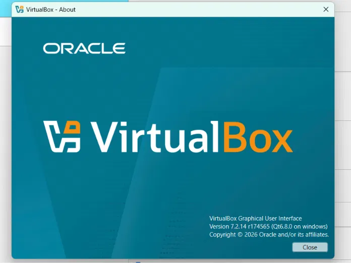

Commands used (PowerShell):

```
systeminfo | findstr /C:"OS Name" /C:"OS Version" /C:"Total Physical Memory" /C:"Available Physical Memory"
Get-CimInstance Win32_Processor | Select-Object Name, NumberOfCores, NumberOfLogicalProcessors
Get-PSDrive C
```

## 3. Lab VM specification

| Item | Value |
|---|---|
| VM name | `linux-log-lab` |
| OS | Ubuntu 20.04.6 LTS (installed from the 20.04.4 Desktop ISO, then `apt upgrade`) |
| Kernel | 5.15.0-139-generic |
| Boot target | `multi-user.target` (no GUI, to save RAM) |
| RAM | 2048 MB (guest shows 1.9 GiB; swap 1.1 GiB) |
| vCPU | 2 |
| CPU processing cap | 100% (no cap). The VM uses at most 2 of the 12 host logical processors. |
| Virtual disk | 25 GB, dynamically allocated (guest `/`: 24 GB, 8.4 GB used, 37%) |
| Python | 3.8.10 (system default) |
| Services | nginx 1.18.0 (active), OpenSSH server (active); listening on 22 and 80 |
| Failed units | 0 (`systemctl --failed`) |

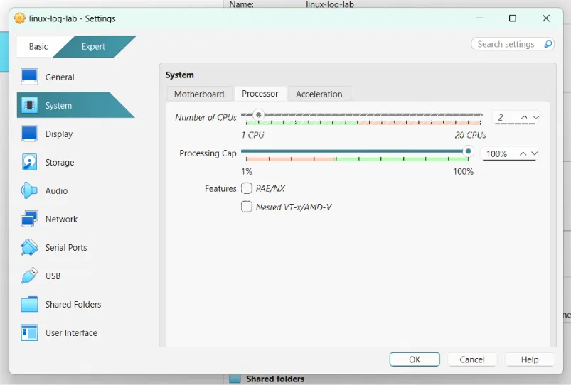

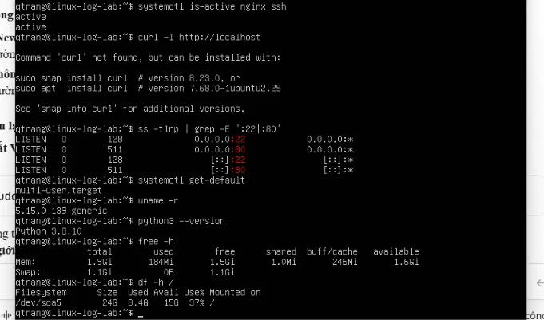

### Network

| Adapter | Type | Address | Purpose |
|---|---|---|---|
| Adapter 1 (`enp0s3`) | NAT | 10.0.2.15 | Outbound internet only (package installs and updates) |
| Adapter 2 (`enp0s8`) | Host-only | 192.168.56.101 (DHCP, may change) | Lab network: SSH and HTTP from the host |

Addresses: `ip -br a` in Figure 8. SSH from the host: Figure 4. HTTP check from the host: Figure 9.

```
ssh <lab-user>@192.168.56.101
curl.exe -I http://192.168.56.101
```

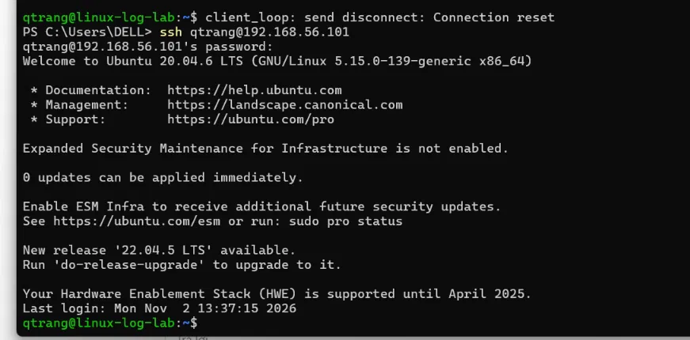

Credentials are shared privately inside the team and are never committed to the repository.

## 4. Clean snapshot

| Item | Value |
|---|---|
| Snapshot name | `clean-baseline-v1` |
| Snapshot UUID | `670a3859-789c-4143-a8fb-818977ad71b4` |
| Description | Ubuntu 20.04.6, nginx 1.18 + ssh, 0 failed units, 02/11/2026 |
| Taken while | VM powered off |

List snapshots (PowerShell):

```
& "C:\Program Files\Oracle\VirtualBox\VBoxManage.exe" snapshot linux-log-lab list --details
```

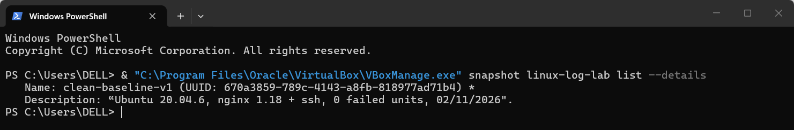

## 5. How to restore the snapshot

Restore before every evaluation run that needs a clean state.

### Using the VirtualBox window (tested)

1. Power off the VM completely (status **Powered Off**).
2. Open the **Snapshots** view of the VM.
3. Select `clean-baseline-v1` and click **Restore**.
4. In the confirmation dialog, leave "Create a snapshot of the current machine state" unticked, then click **Restore** (Figure 6).
5. Start the VM and check it (section 6).

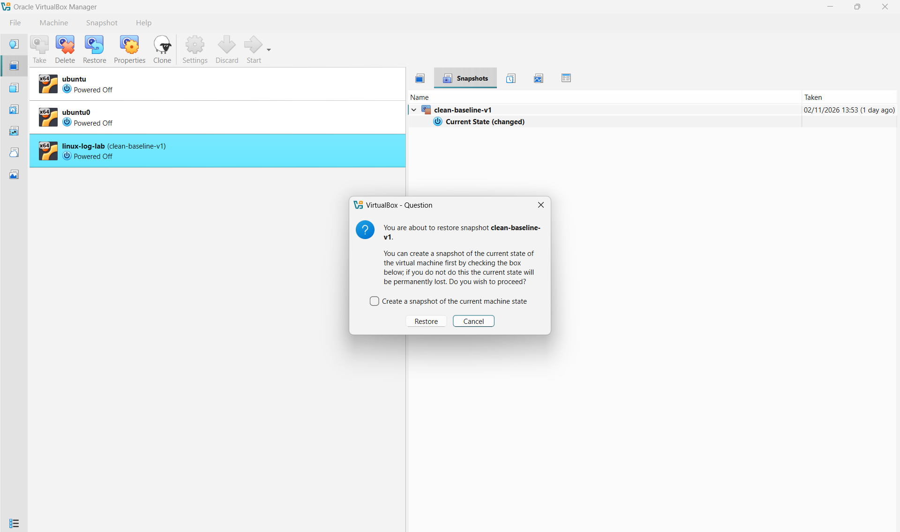

### Using the command line (alternative, not tested yet)

```
& "C:\Program Files\Oracle\VirtualBox\VBoxManage.exe" controlvm linux-log-lab poweroff
& "C:\Program Files\Oracle\VirtualBox\VBoxManage.exe" snapshot linux-log-lab restore clean-baseline-v1
& "C:\Program Files\Oracle\VirtualBox\VBoxManage.exe" startvm linux-log-lab --type headless
```

Restoring discards everything done in the VM after the snapshot was taken.

## 6. Restore test result

The test was first done on 2026-11-02 and repeated with full screenshots on 2026-11-04 (times below are from the screenshots).

1. 13:29 - In the running VM: `nginx` and `ssh` were `active`; created `~/marker-before-restore.txt`; ran `sudo systemctl stop nginx`; `systemctl is-active nginx` returned `inactive` (Figure 7).
2. 13:35 - Powered off the VM and restored `clean-baseline-v1` from the VirtualBox window (Figure 6).
3. 13:43 - Started the VM and checked, **without starting any service by hand**:

| Check | Result |
|---|---|
| `ls ~/marker-before-restore.txt` | `No such file or directory` (file is gone) - Figure 8 |
| `systemctl is-active nginx ssh` | `active` and `active` - Figure 8 |
| `systemctl --failed` | `0 loaded units listed` - Figure 8 |
| `curl.exe -I http://192.168.56.101` from the host | `HTTP/1.1 200 OK`, nginx/1.18.0 - Figure 9 |

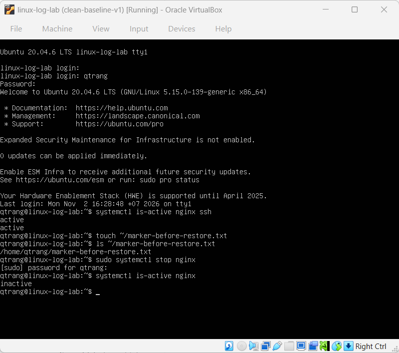

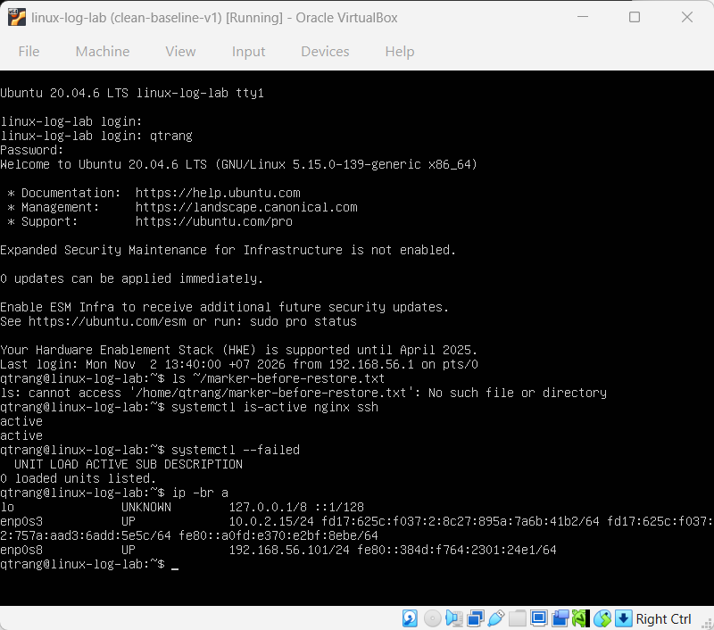

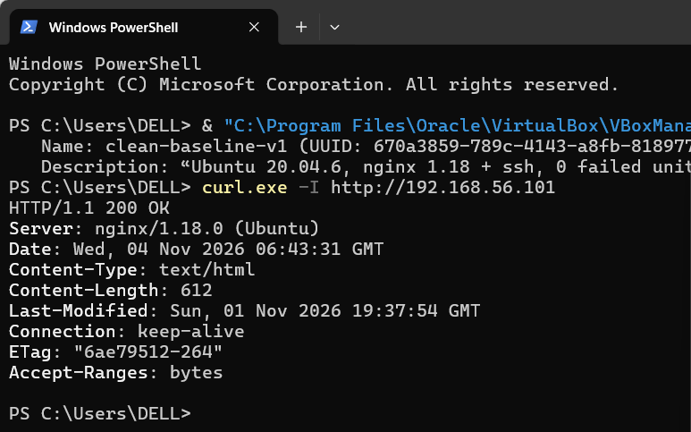

The restore returned the VM to the clean state.

## 7. Running the VM and a local LLM together (low-spec laptop test)

Goal: find out whether the VM and a local Ollama model can run at the same time on a low-spec 8 GB laptop. This is a **worst-case reference on one laptop** and does not change the team baseline, **Qwen3 4B Instruct** (`qwen3:4b-instruct-2507-q4_K_M`). Two models were tried: `qwen2.5:3b` (2026-11-02) and the baseline 4B model (2026-11-04). For the 4B adapter smoke test on another machine, see PR #4.

Conditions (both tests):

- Host: section 2, CPU-only inference.
- VM `linux-log-lab` running with 2048 MB RAM.
- Ollama 0.40.13; same prompt: "Journald trên Linux dùng để làm gì? Trả lời ngắn."
- 3B test: Chrome with 1 tab, no other heavy applications.
- 4B test: **more applications were open** (available memory before the model was 558 MB instead of 1,081 MB), so the two tests are not under identical conditions.

Memory:

| Moment | `qwen2.5:3b` (11-02) | `qwen3:4b-instruct` (11-04) |
|---|---|---|
| VM running, model not loaded (`systeminfo`) | 1,081 MB available | 558 MB available |
| After the first run (`systeminfo`) | 875 MB available | 643 MB available |
| Task Manager after the run | 7.0 / 7.7 GB used (91%), CPU 53% | 7.3 / 7.7 GB used (95%), 390 MB available, CPU 44% |

`systeminfo` "available" memory moves with caching and compression, so the Task Manager reading is the better indicator of headroom.

Model speed (`ollama run --verbose`):

| Metric | 3B run 1 | 3B run 2 | 4B run 1 |
|---|---|---|---|
| Load duration | 13.1 s | 19.2 s | 11.5 s |
| Total duration | 19.6 s | 25.5 s | 21.5 s |
| Prompt tokens / rate | 44 / 20.8 tokens/s | 44 / 15.6 tokens/s | 23 / 15.7 tokens/s |
| Generated tokens | 22 | 18 | 40 |
| Generation rate (eval rate) | 5.20 tokens/s | 5.35 tokens/s | 4.69 tokens/s |

Prompt token counts differ because the two models use different tokenizers. The 4B model was run once.

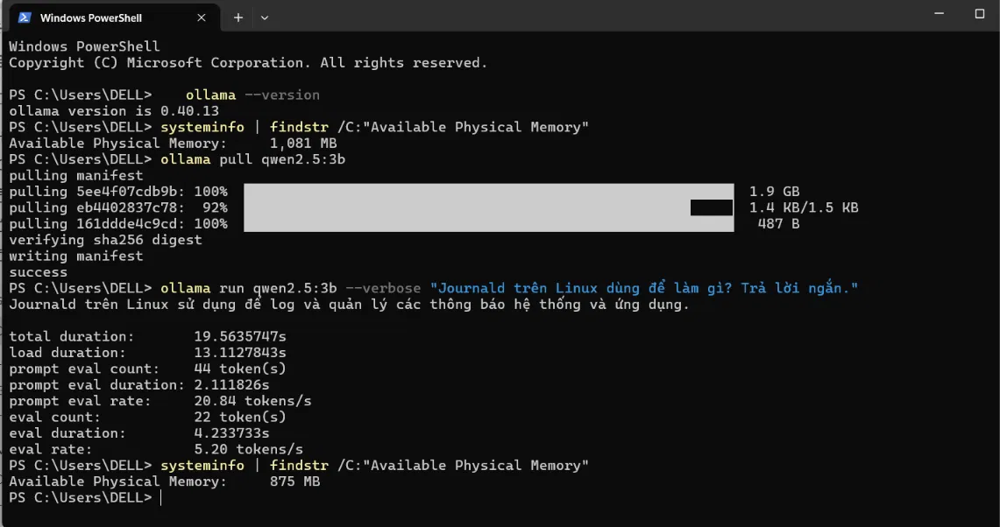

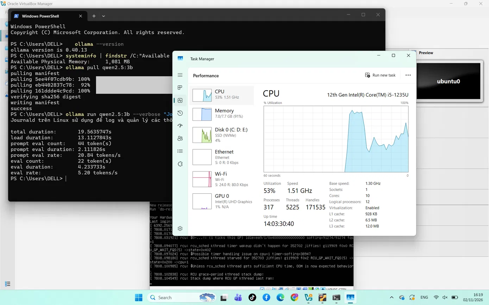

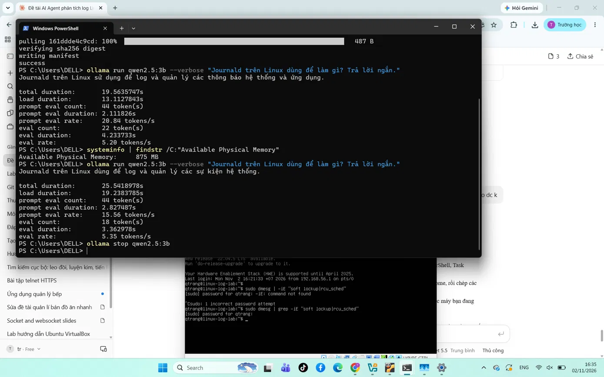

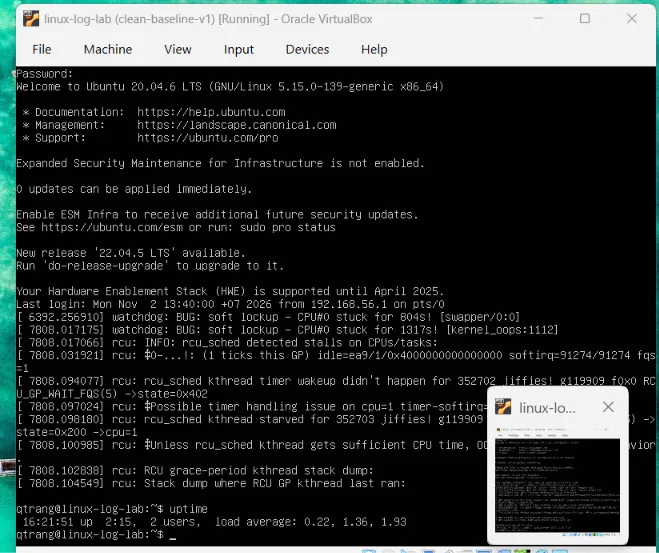

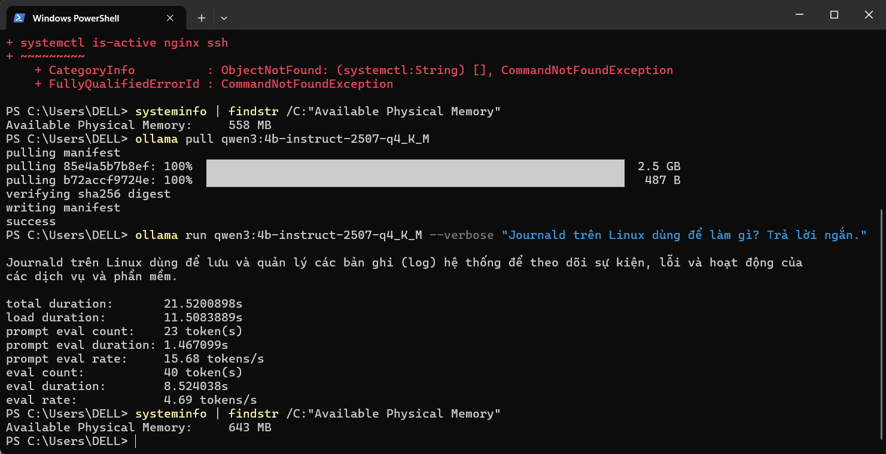

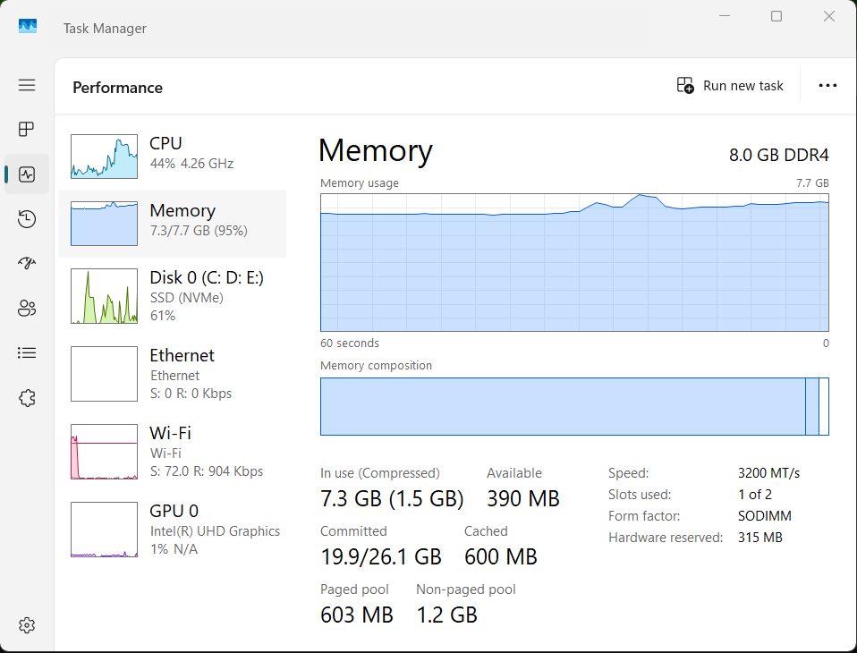


VM behavior:

- During the 3B session the VM console showed `watchdog: BUG: soft lockup - CPU#0 stuck for 804s` and `1317s`, plus `rcu_sched` stall warnings (Figure 13). The cause is not confirmed; possible causes are host memory pressure, or the laptop being paused or asleep while the VM was running.
- After the 4B test (2026-11-04, 14:16) the VM answered `uptime` immediately (up 36 min, load average 0.01). `sudo dmesg | grep -iE "soft lockup|rcu_sched"` returned no output. The VM had been restored and rebooted at about 13:40, so this covers the 4B run (about 14:10). It was checked a few minutes after the run, not during it (Figure 16).

Conclusion (this laptop only):

- Both the 3B model and the 4B baseline model ran to completion next to the 2 GB VM. No soft lockup was logged during the 4B session. With the 4B model, memory use reached 95% with only 390 MB available at the lowest reading, so there is almost no headroom.
- Generation speed with 4B was about 4.7 tokens/s, roughly 10% slower than 3B (5.2-5.35 tokens/s), with a short prompt. Longer agent prompts were not measured.
- 7B-8B models were not tested.
- On this laptop, close other applications before running the VM and the model together. Members with more RAM should get more headroom. Each member should run the same smoke test on their own machine.

## 8. Known limitations

- Ubuntu 20.04 is past its standard support period (the login banner says Hardware Enablement support ended April 2025). Do not run `do-release-upgrade`, so the baseline stays the same for everyone.
- **Network isolation:** Adapter 2 (Host-only) is the lab network; fault scenarios and agent access use only this adapter. Adapter 1 (NAT) gives the VM outbound internet access and is used only for package installs and updates. Because NAT is enabled, the VM is **not fully isolated** from the internet. Disable Adapter 1 during fault-injection and evaluation runs if full isolation is required.
- The default Python is 3.8. The official MCP Python SDK needs a newer Python (3.10 or later; verify on the SDK page). If the MCP server runs inside the VM, install a newer Python first.
- The Host-only address is assigned by DHCP and may change after the network is recreated. Check it with `ip -br a` inside the VM.

## 9. Acceptance criteria check

| Criterion | Status |
|---|---|
| Snapshot restore succeeds | Done (section 6), pending review |
| No incident created on the host | Done (only the VM was modified) |
| VM and model concurrency determined | Done for `qwen2.5:3b` and the 4B baseline on this low-spec machine (section 7); 7B-8B not tested |
