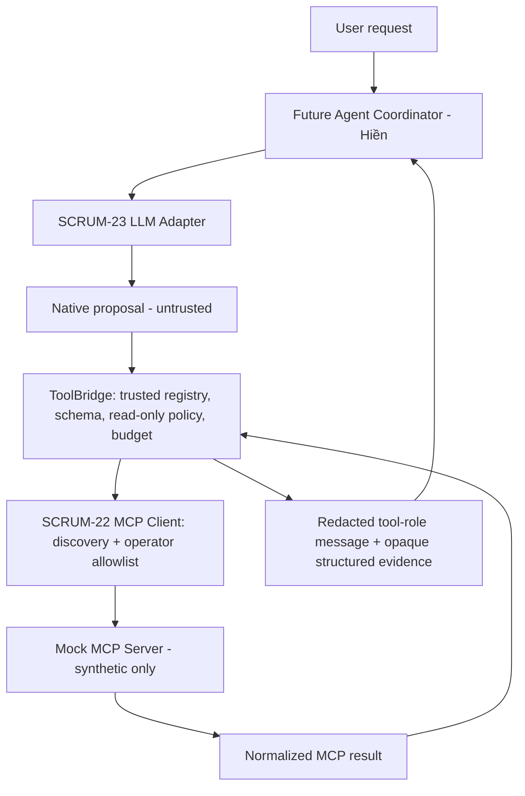

# SCRUM-22 — Contract-independent integration boundary

Chuẩn bị kết nối MCP Client và Adapter đã merge, **không phải MCP integration hoàn
chỉnh, SCRUM-12 contracts hay SCRUM-24 loop**. Chỉ một proposal/lần; không gọi LLM,
không suy luận/chọn tool tự động, không approval và không chạy write operations.

## Quyền sở hữu và luồng dữ liệu



| Trách nhiệm | Owner/boundary |
|---|---|
| Registry, version và input/output contracts 12 tools | Thủy điều phối SCRUM-12; Hiền/Trang xác nhận phần sở hữu. Discovery/annotations không cấp quyền. Không nạp trực tiếp PR #6 đang Draft về nội dung. |
| Chọn subset read-only, launch manifest và trusted business definitions | Ứng dụng/operator. Không lấy schemas/read_only/entrypoint/env từ LLM/log. |
| Validate proposal | Adapter validate native calls; ToolBridge validate độc lập name/arguments và read-only policy. MCP Client vẫn yêu cầu discovery + allowlist; Server phải validate lại. |
| Logical call ID / attempt ID | Future Coordinator tạo logical ID cho một ý định, mỗi attempt có ID riêng; MCP Client gắn metadata theo contract finalized, Server echo; SDK sở hữu JSON-RPC ID. **Chưa implement metadata injection/ID fields ở đây.** Provider ID của Ollama không thay các ID này. |
| Kết quả → LLM | ToolBridge giữ `isError`, `content`, `structuredContent` trong JSON cho `Message(role='tool')`. Đây là representation nội bộ, không phải envelope mới của MCP. |
| Evidence/provenance | Giữ opaque structured fields, IDs, source, timestamp, cursor và partial flags nếu redactor không cần che; không tự parse text thành evidence, không tạo citation/event/health verdict. Redacted view này không phải authoritative evidence store/audit. |
| Redaction | Collector/Server trước egress; ToolBridge bắt buộc injected redactor trước model-message và kiểm arguments không bị thay nội dung; Adapter tiếp tục lọc trước HTTP. Không có identity/default-redactor cho runtime. |

## API và hành vi

`TrustedTool(name, description, parameters, read_only)` là cấu hình ứng dụng,
không phải schema mới của 12 tools. Schema dùng Draft2020-12, root object; hỗ trợ
local refs, chặn external refs và mọi resolver retrieval. Ứng dụng phải review các
constraints/regex; JSON Schema validation chạy synchronous, không phải CPU sandbox.
Registry/arguments được copy để tránh caller sửa nội dung đang validate. `definitions()`
chỉ xuất các tool read-only, trả bản copy cho mapping `ToolDefinition` của SCRUM-23.

`ToolBridge(client, tools, redact=reviewed_filter, budget=BridgeBudget())` nhận MCP
Protocol, không phụ thuộc SDK/LLM implementation. Caller tự connect/discover/disconnect
bằng `async with StdioMCPClient(...)`. Khi request lỗi/hủy, bridge yêu cầu disconnect
và giữ quyền sở hữu việc chờ cleanup; không mở SDK context hoặc tự reconnect.

`await bridge.execute(name, arguments)`:

1. Từ chối unknown tool/write, JSON-string args, nonfinite JSON, schema errors,
   secret arguments (redaction làm đổi giá trị → reject, không sửa rồi dispatch).
2. Kiểm budget và BUSY; gửi tối đa **một** `call_tool`; không retry bất kỳ operation.
3. Giữ tool `isError=true` là result, không biến thành exception transport.
4. Chỉ nhận text content và optional structured object; không fetch resource/image.
5. Serialize JSON UTF-8 có giới hạn; redactor bắt buộc, fail closed khi lỗi hoặc JSON
   hỏng; giữ root fields/isError. Không truncate JSON và không tự đổi status partial.
6. `ToolMessage.message_fields()` dùng được với `Message(**fields)` của Adapter nếu
   chưa hết time budget. Repr không chứa content. Không log payload/arguments/reasoning.

`BoundaryError.code/layer` chỉ có mã an toàn. Phân biệt:

- `policy`: UNKNOWN_TOOL, WRITE_NOT_ALLOWED, INVALID_ARGUMENTS, INVALID_SCHEMA,
  DATA_POLICY, BUDGET_EXHAUSTED, BUSY; dữ liệu không được dùng để tự cấp quyền.
- `transport`: TIMEOUT, DISCONNECTED, TRANSPORT_ERROR, CLEANUP_TIMEOUT,
  NOT_CONNECTED, RESULT_TOO_LARGE, TOOL_NOT_ALLOWED… từ MCP Client.
- `protocol`: PROTOCOL_ERROR, MALFORMED_RESULT, UNSUPPORTED_RESULT.
- Tool business error/partial/status giữ nguyên trong dữ liệu đã lọc; **không diễn
  giải error_code hoặc status của SCRUM-12** khi chưa chốt. Không giả `partial=ok`.

Mặc định 4 calls, 30s scope, 10s/request, **8s/cleanup join**, 64 KiB mỗi schema/args/model message;
config tối đa 8 calls, 120s scope, 60s/request, 60s/cleanup join, 64KiB. Budget bắt đầu khi tạo bridge,
không reset; tool error/timeout vẫn tính lượt đã dispatch. Validation rejection không
tính tool call. Không queue/parallel calls; scope phải thuộc một coordinator request.

Bridge giữ một request task và dùng `asyncio.wait` với request budget. Khi hết hạn,
chỉ hủy request task tối đa một lần; nếu task đang chờ Client cleanup thì rejoin
**cùng owner**, không hủy owner lần hai. Client vẫn là nơi enter/exit SDK/AnyIO
contexts trong cùng task. Caller cancellation lặp không truyền xuống cleanup task.

`cleanup_seconds` độc lập request/total budget; `cleanup_state` là `idle`, `pending`,
`confirmed` hoặc `unconfirmed`. Hết cleanup budget trả `CLEANUP_TIMEOUT`, giữ task
reference trong bridge/Client, chặn call mới bằng `CLEANUP_PENDING`. Caller **phải
giữ bridge và gọi `await bridge.finish_cleanup()`** để xác nhận/rejoin cleanup,
kể cả khi task đã kết thúc sau timeout. Không bỏ bridge ngay khi nhận lỗi này.
Mỗi lần rejoin có cleanup budget riêng; không resend tool, reconnect hay tăng request
deadline. Nếu cleanup vẫn treo, tiếp tục báo chưa xác nhận; không giả vờ đã đóng.
Caller cancellation được truyền lại sau cleanup; nếu cleanup hết budget trước,
ưu tiên báo `CLEANUP_TIMEOUT` để yêu cầu caller giữ ownership. `has_pending_task`
chỉ phản ánh worker của bridge; cần kiểm cả `cleanup_state` và owner của Client.

Outcome nội bộ phân biệt `phase`: `not_dispatched`, `awaiting_result`,
`result_received`, `sanitized`; `execution_state`: `not_dispatched`, `unknown`,
`response_received`. Timeout/disconnect trước response là **unknown**, không chứng
minh tool chưa chạy hoặc rollback. `BoundaryError` chỉ in mã an toàn, kèm phase/state.

Nếu response đã validate và sanitize thành công nhưng time budget hết, `execute`
vẫn trả bounded `ToolMessage(budget_exhausted=True)` và giữ `bridge.safe_result`.
Evidence/provenance đã lọc dùng cho báo cáo nội bộ; `message_fields()` từ chối bằng
`BUDGET_EXHAUSTED` (kèm `safe_result`) và call tiếp theo bị chặn. Không gọi LLM tiếp.
Caller không được bỏ qua cờ này bằng cách tự tạo message. Trước dispatch hết budget
thì không gọi MCP; redaction/validation/size failure không trả raw result. Last safe
result được giữ đến khi có dispatch mới; result lỗi không kế thừa evidence của lượt cũ.
Đây là fields nội bộ, **không thêm vào wire contracts SCRUM-12**. Hết số lượt tool
chặn dispatch tiếp; tự nó không xóa evidence hoặc cấm summary trong time budget.

Cleanup có thể về sau request deadline. Synchronous validation/redaction và Adapter
HTTP hiện tại không thể bị preempt bằng timeout này: **chưa có hard wall deadline**.
Không wrap sync Adapter bằng to_thread rồi tuyên bố đã hủy HTTP worker.

64KiB ở đây là cap JSON nội bộ **sau SDK parse**, không phải cap wire finalized
của SCRUM-12. Giữ cả content + structuredContent có thể tăng kích thước; reject
RESULT_TOO_LARGE thay vì âm thầm bỏ evidence. Collector/frame caps vẫn cần Thủy.

## Chạy tests, không inference hoặc package install

Từ worktree SCRUM-22, dùng Python 3.12 venv đã có. MCP-only offline giữ dependency
stdlib; boundary thêm jsonschema/referencing theo requirements riêng đã kiểm tra.

```bash
PYTHONDONTWRITEBYTECODE=1 PYTHONPATH=src .venv-scrum22-py312/bin/python -m unittest discover -s tests/mcp_client -p 'test_*.py' -q
PYTHONDONTWRITEBYTECODE=1 PYTHONPATH=src .venv-scrum22-py312/bin/python -m unittest discover -s tests/integration_boundary -p 'test_*.py' -q
```

Nhánh PR #7 chưa chứa Adapter mới trên main. **Không merge/rebase/copy Adapter vào
nhánh** chỉ để chạy tests. Runner sau đọc Git archive của main vào TemporaryDirectory,
ghép source MCP/boundary hiện tại và chạy ba suites với PYTHONPATH tạm; in baseline
commit để xác định nguồn. Không sửa Git/worktrees, không fetch/install tự động:

```bash
PYTHONDONTWRITEBYTECODE=1 .venv-scrum22-py312/bin/python tests/integration_boundary/run_composed_tests.py --baseline-ref origin/main
```

Mặc định skip stdio thật. Chỉ khi môi trường cho phép subprocess/SDK2.3.0:

```bash
RUN_MCP_STDIO_SMOKE=1 PYTHONDONTWRITEBYTECODE=1 .venv-scrum22-py312/bin/python tests/integration_boundary/run_composed_tests.py --baseline-ref origin/main
```

Test HTTP luôn dùng MockHTTP; không đụng endpoint Ollama. Test stdio dùng
`tests/mcp_client/mock_stdio_server.py` hiện có: echo, asyncio wait, self-exit để
simulate disconnect; marker trong TemporaryDirectory. Không dùng server của Thủy.
`fixtures.py` chỉ là synthetic contracts minh họa, không bàn giao contracts dự án.
`test_adapter_optional.py` chỉ skip khi thiếu package Adapter; lỗi dependency/import
khác phải fail, không âm thầm bỏ qua.

## Chờ SCRUM-12 / trước demo log thật

1. Manifest/version + đủ input/output schemas tự chứa; mapping trusted schemas sang
   discovery/LLM nhất quán; business fields tách metadata do ứng dụng cấp.
2. Logical/attempt/trace/session binding và vị trí metadata; không thêm wire fields
   khi chưa thống nhất. Chưa dùng PR #6 Draft như finalized contracts.
3. structuredContent/error/partial/approval_required mapping, error enums, semantic
   validation/evidence provenance/time/cursor/UTF8 output policy và output validators.
4. Không parser fallback từ text để che thiếu structuredContent; legacy text chỉ là
   untrusted content. Chưa chứng minh evidence/citations hoặc health verification.
5. Registry/schema attestation từ server trusted và business-result interpreter cần
   review trước tool thật. Read-only flag là policy của operator, không bảo đảm OS
   read-only nếu deployment/server bị cấu hình sai.
6. Bộ lọc Adapter hiện tại còn các follow-ups đã biết (MYSQL_PWD, URL credentials,
   Bearer formatting, token_count false positive); **không coi log thật đã an toàn**.
   Injecting một callable không chứng minh độ bao phủ redaction.
7. Python3.12/least privilege/NNP/network/collector caps trong VM và ≥1 real read-only
   tool là gate tiếp theo; mock PASS không hoàn tất SCRUM-22 hoặc SCRUM-23 integration.

Xem REPORT.md để biết kết quả thực tế và các phần PASS/NEEDS CHANGE/BLOCKED/FOLLOW-UP.
